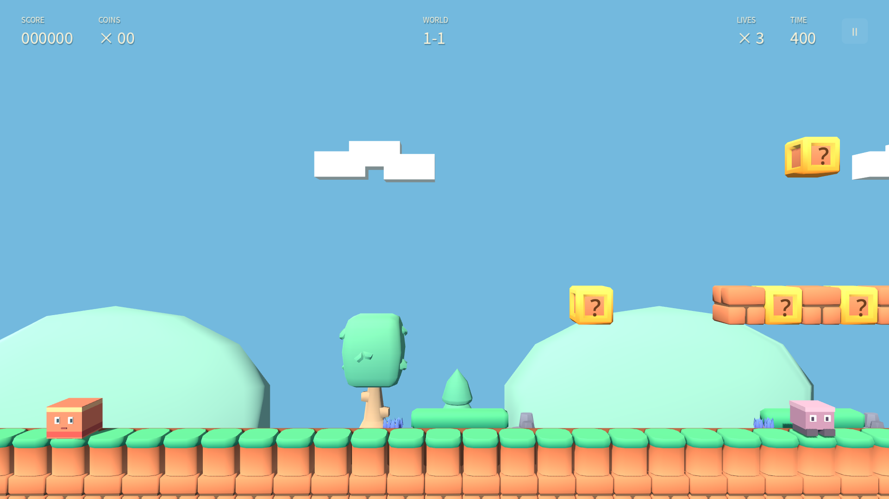
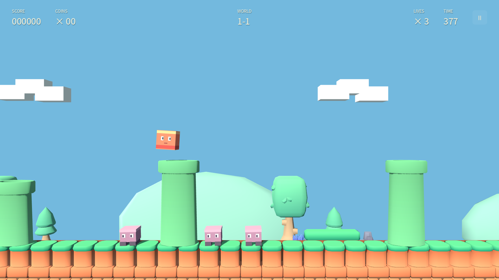
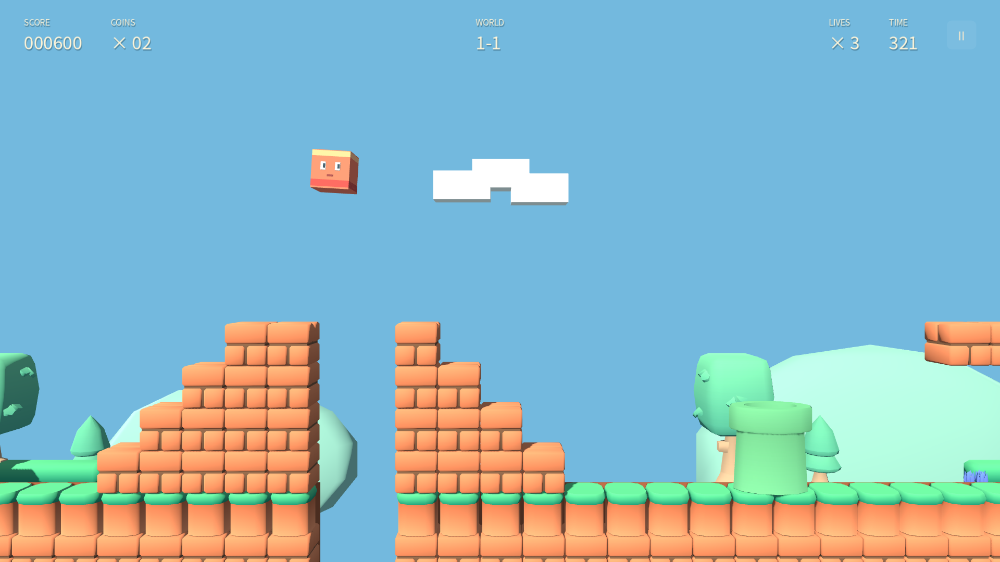
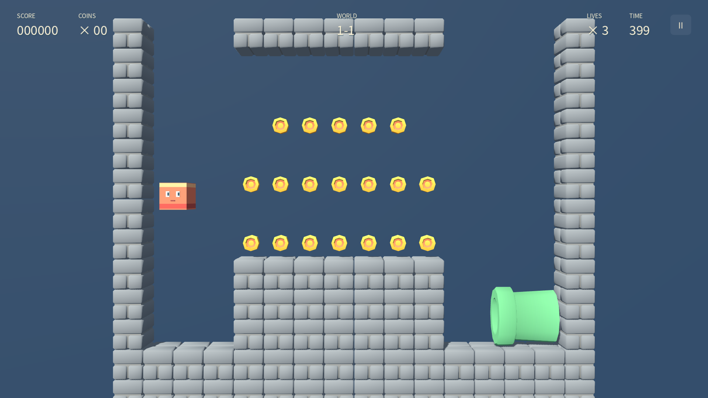
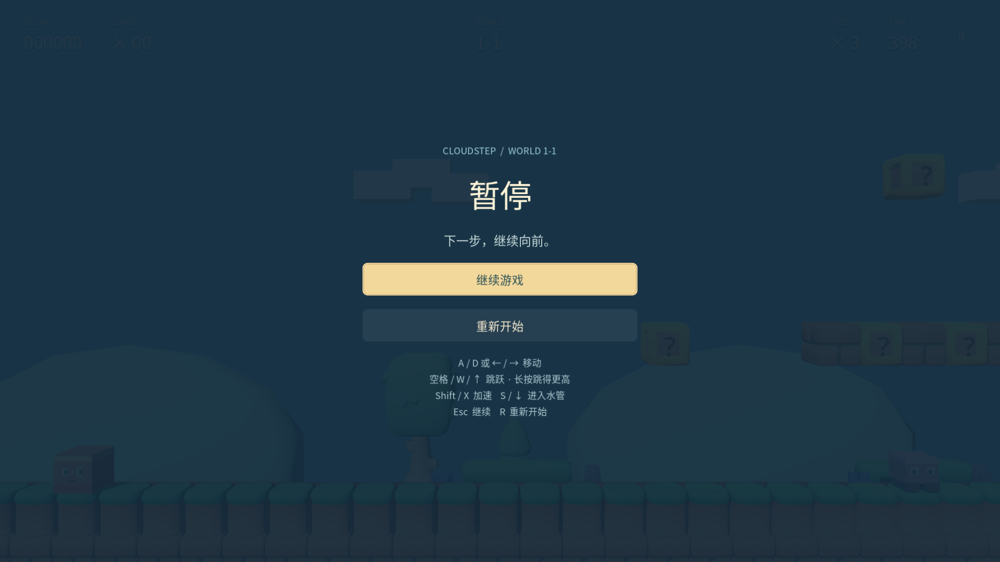
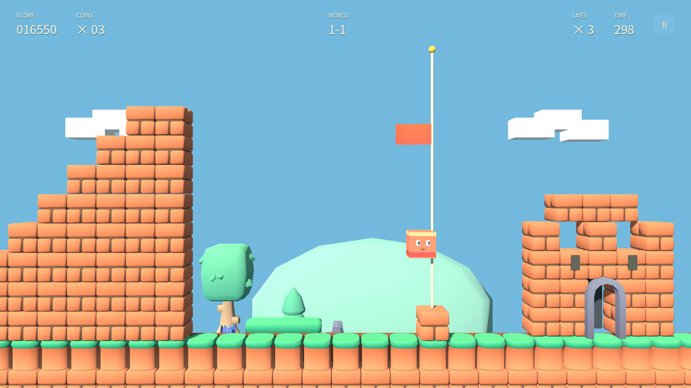
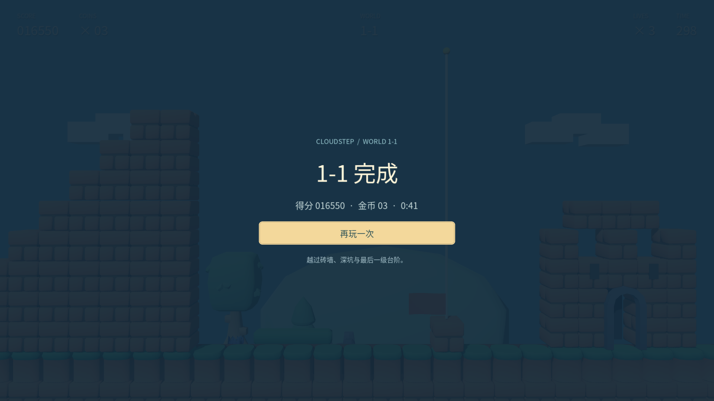

# Cloudstep · World 1-1

以《Super Mario Bros.》NES 版第一关 **World 1-1 的关卡布局为参考**，制作的 3D 方块横版游戏。默认进入新关卡：统一一格大小的地面、悬空砖和台阶，保留珊瑚色 Cube 主角与纯水平 3D 透视镜头。环境与道具采用 Kenney CC0 模型，玩家与敌人仍保留原有造型；界面和合成音效为原创。不包含 ROM、原版贴图、角色精灵、音乐或商标素材。资产文件、作者、许可证及修改方式见 [ASSET_SOURCES.md](ASSET_SOURCES.md)。

## 运行

- Godot **4.7.2 stable**，GL Compatibility；Windows / macOS / Linux。
- 导入 `project.godot` 后按 **F5**。默认场景为 `scenes/world11.tscn`。
- 命令行：`godot --path /path/to/CubePlatformer`。
- 无插件、无网络服务，无需额外下载资产。

## 玩法

- **A / D 或 ← / →**：左右移动。
- **Space / W / ↑**：跳跃；长按跳得更高，松开短跳。
- **Shift / X**：加速跑。
- 从下方顶问号块领取金币或蘑菇；蘑菇使主角长高，大形态可撞碎普通砖。受击后缩小并短暂无敌，小形态再受击会失去一条生命。
- 落到敌人头顶可以踩倒；绿色甲壳敌人可踩成壳、踢动，再踩停。星形奖励提供短暂无敌，隐藏奖励增加生命。
- 站在**第四根水管顶端，按 S / ↓**进入地下金币房；从右侧横管离开，回到第五根水管。
- 越过三处地面缺口和终点阶梯，碰到旗杆后降旗并走向城堡结算。旗杆奖励随触碰高度变化，剩余时间转化为分数。
- **Esc / 右上角暂停按钮**：暂停；失去窗口焦点时也暂停。
- 暂停、失败或通关后点击重新开始，或按 **R**，重置整局。
- 操作说明只在暂停界面显示。常驻 HUD 只显示分数、金币、关卡、生命、时间和暂停，没有教学条或调试信息。

## 地图与实现

- `scripts/world11_data.gd`：独立数据驱动地图。以原图 16 像素为一格，0-based X 坐标，地面顶面 Y=0。
- 地上路线 **208 列**；缺口为 `[69,71)`、`[86,89)`、`[153,155)`；6 根水管、44 个互动块、5 段阶梯、16 个小怪与 1 个甲壳敌人（其中两只小怪位于上方砖台）。旗杆底座在第 198 列，城堡位于第 202–206 列。
- 地面和台阶每格都是单独的真实 3D 模型，按完整 AABB 适配为相同的 0.982³ 格子；地面上层为草地块，下层及台阶为砖块。不使用整片浮岛、不使用半格偏移。渲染块有细缝，连续地面的碰撞体按区间合并，避免角色卡在砖缝上。
- `scripts/world11_assets.gd`：Kenney 模型的纯视觉适配与调色；不生成碰撞体。来源与可复现派生工具见 [资产来源清单](ASSET_SOURCES.md)。
- `scripts/world11_block.gd`：问号、普通砖、多金币砖和隐藏奖励。可交互块各有独立一格碰撞体。
- `scripts/world11_player.gd`：0.90³ Cube 小形态、1.80 高成长形态；移动锁定 Z=0，含土狼时间、跳跃缓冲、可变跳高和轻微挤压反馈。
- `scripts/world11_enemy.gd`、`scripts/world11_item.gd`：敌人激活、踩踏、甲壳与奖励移动。远处敌人在玩家接近后激活；进入地下房时地上敌人冻结。
- `scripts/world11.gd`：场景生成、金币房、水管转场、生命、计时、旗杆、界面与结果流程。
- 镜头为真正的 Perspective Camera3D；旋转始终为 0°，不俯视、不环绕，仅水平平滑跟随。垂直视场角 46°、距离 16、高度 5，适配最高 8 格的平台与终点阶梯。跳跃不会上下追镜。

### 实现边界

这是依据地图复建的 3D 方块演绎，**不是逐帧物理仿真或完整原作移植**。跳跃、惯性、碰撞、敌人初始半格位置和旗杆计分做了独立实现；造型与背景重新设计。保留三处成长奖励，但成长后再次领取仍为蘑菇，暂未实现火焰形态/火球；没有原作中点复活逻辑、烟花和跨关切换。失败后从本关开头继续，生命耗尽后可整局重开。地下房保留 19 金币、三层金币排列、砖台及入口/出口路线。

### 布局参考

以下页面用于核对关卡几何和基本机制；参考图片仅在开发时查看，未打包入项目。

- [MarioWiki：World 1-1 地图](https://www.mariowiki.com/File:SMB_NES_World_1-1_Map.png)
- [NESMaps：World 1-1 标注地图](https://www.nesmaps.com/maps/SuperMarioBrothers/SuperMarioBrosWorld1-1Map.html)
- [Nintendo：原版说明书](https://www.nintendo.co.jp/clv/manuals/en/pdf/CLV-P-NAAAE.pdf)

注意：部分参考整图右侧附带地下房，不能把该附图当作地上路线的后续列。

## 测试

在工程目录运行：

```sh
godot --headless --path . --script res://tests/qa_world11_assets.gd
godot --headless --path . --script res://tests/test_world11_actors.gd
godot --headless --path . --script res://tests/qa_world11.gd
godot --headless --path . --script res://tests/qa_world11_route.gd
godot --headless --path . --script res://tests/qa_world11_bonus.gd
```

美术适配另有 22 项独立检查，覆盖归一 AABB、全部纹理、地面格子、六根水管、方块状态和奖励模型。新关的 26 项角色专项与 46 项独立功能检查覆盖地图、网格几何、顶砖奖励、踩怪、成长受击、暂停、地下房与失败重开。整条主路线只用正常移动/跳跃输入跑通，敌人与物理保持启用；地下支线单独验证真实输入收齐 19 枚金币并返回地上。测试失败会返回非零退出码。

原“云上花园”关卡保留在 `scenes/main.tscn`，不作为默认启动关卡；其源文件和原有测试独立保留。可在编辑器打开该场景并按 F6，或运行 `godot --path . res://scenes/main.tscn`。说明见 [旧关卡文档](docs/legacy-garden.md)。

```sh
godot --headless --path . --script res://tests/test_game.gd
godot --headless --path . --script res://tests/test_route.gd
godot --headless --path . --script res://tests/test_camera.gd
godot --headless --path . --script res://tests/test_bricks_ui.gd
```

开发截图位置参数：`godot --path . -- --world-view=middle`，另支持 `start`、`stairs`、`end`；这些参数不会出现在游戏界面，正常启动从开头开始。

## 实机画面

以下画面由 Godot 4.7.2 原生 OpenGL 渲染直接导出，1920×1080；主线截图来自从默认起点以移动/跳跃输入跑通的同一局；地下与暂停为独立原生检查画面，没有后期拼合。















截图脚本 `tests/qa_world11_capture.gd` 需要图形显示环境；完整路线脚本支持 `-- --render --output=/your/capture/folder` 输出沿途截图。旧云上花园的截图保留在原位置，两套关卡互不覆盖。

## 资产与许可

代码和原创 3D 几何、材质、UI、合成音效以 MIT 许可证提供，见 `LICENSE`。新环境与道具采用 **Kenney Platformer Kit 4.1 / CC0 1.0**，其原始许可证与逐文件 SHA-256 清单已随工程保留；完整来源、用途及改动见 [ASSET_SOURCES.md](ASSET_SOURCES.md)。本实现不是 Nintendo 官方作品；原作名称及其相关权利属于各权利人，布局参考不意味着对原作内容授予许可。

中文字体采用未修改的 Noto Sans CJK，使用 SIL Open Font License 1.1；上游 https://github.com/notofonts/noto-cjk ，完整许可证见 `third_party/Noto-LICENSE.txt`。Godot 使用 MIT 许可证，源码仓库不包含引擎二进制。
