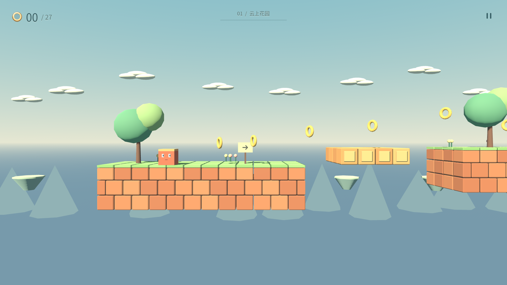
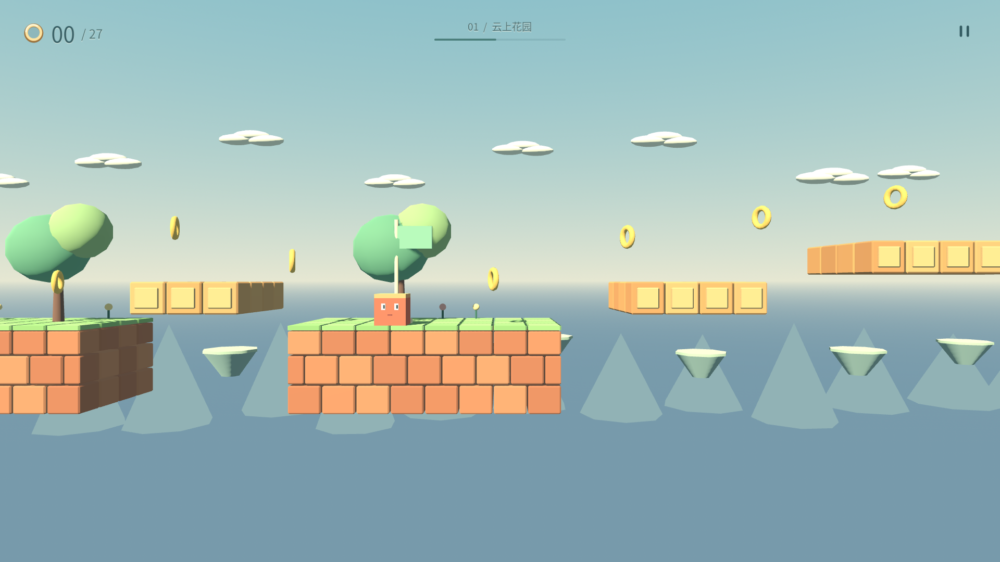
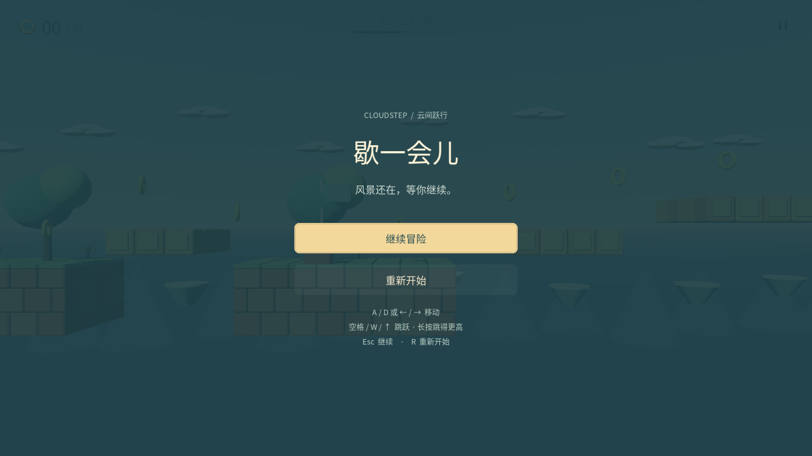
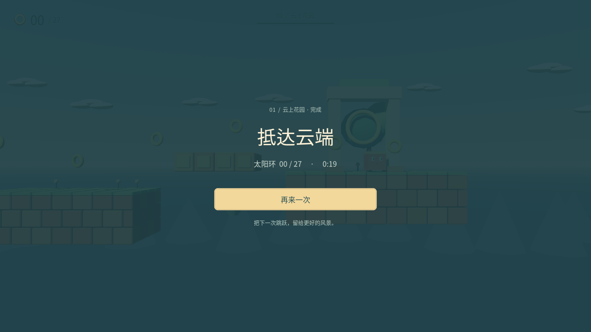

# Cloudstep · 云间跃行（旧关卡）

本页记录保留的云上花园场景；默认启动已切换到 World 1-1，见[当前说明](../README.md)。

原创 2.5D 横版跳跃小游戏。3D 水平透视侧视镜头、珊瑚色 Cube 角色、云海砖园与阳光庭园。独立项目，不引用或修改其他游戏工程。

## 运行

- 推荐 Godot **4.7.2 stable**（GL Compatibility，Windows / macOS / Linux）。
- Godot 项目管理器导入本目录 `project.godot`，打开后按 **F6** 运行当前场景或 **F5** 运行项目。
- 命令行：`godot --path /path/to/CubePlatformer`
- 无第三方插件、无网络服务、无需额外资产下载。

## 玩法

- **A / D** 或 **左右方向键**：移动。
- **Space / W / 上方向键**：跳跃；长按更高，松开短跳。
- 收集金色太阳环，越过沟壑和紫色尖刺，到最右侧的太阳门通关。
- 中途旗帜是检查点；坠落或碰到尖刺会在最近检查点复活，已收集金币保留且不会重复计数。
- **Esc** 或右上角暂停图标：暂停/继续；失去窗口焦点时也会自动暂停。
- 暂停或通关后点击按钮，或按 **R**：从头再来，所有本局状态重置。
- 实机 HUD 只保留浮动太阳环计数、细关卡进度和暂停图标；操作说明收进暂停界面，没有常驻教学条或调试面板。

## 实现与编辑

- `scenes/main.tscn`：主关卡；12 个命名平台均为独立场景树节点，可直接改位置、宽度、深度和厚度。
- `scenes/player.tscn`、`scripts/player.gd`：CharacterBody3D 物理角色；锁定 Z 平面、加减速、120ms 土狼时间、140ms 跳跃缓冲、可变跳高、落地挤压反馈。
- `scripts/platform.gd`：`@tool` 模块化砖砌生成器，约 1 单位的砖块与 0.92 单位立方体角色同尺度；地面使用三排错缝砌块及逐块草皮，5 个短平台使用单排悬空砖块。每块砖都是独立变换的真实倒角几何体，前面、顶面、侧面均有接缝；用 MultiMesh 合批，不是覆盖在大土块上的砖纹。
- 每个平台仍只有一个完整的 BoxShape3D 碰撞体，视觉砖缝不参与分割物理顶面。原有平台横坐标、宽度、着陆高度不变；不会因为砖缝卡住角色。`floating` 可切换悬空砖排，`thickness` 控制排数。
- `scenes/coin.tscn`、`scripts/coin.gd`：可复用太阳环；Area3D 拾取防重复。
- 镜头：真正的 Perspective Camera3D，垂直视场角 50°、Z 距离 18，俯仰/偏航/翻滚全部为 0°；高度固定为 1.3（起点角色位于约 55% 画面高度），仅横向平滑跟随，跳跃不产生俯视或上下追镜。近大远小来自真实 3D 投影，远岛、云和山逐层向后退。
- 平台前沿位于 Z=0.5，与角色正面基本对齐，其余深度向后延伸；脚底与可跳跃边缘清晰一致。低光轴高度令透视主要呈现侧面，起点仅少量顶面，高平台可见底面，不使用倾斜镜头。角色主体为 0.92 × 0.92 × 0.92 的立方体，仅跳跃/着陆时短暂挤压。
- `scripts/main.gd`：关卡装饰、危险区域、旗帜/终点、UI 与游戏流程。新增金币可修改 `_build_pickups()` 的二维坐标表；危险物可修改 `_build_hazards()`。
- `scripts/shapes.gd`：原创基础网格、26 面倒角砖块与材质；`scripts/hud_icon.gd`：矢量绘制的太阳环及暂停图标；`scripts/sound.gd`：原创合成音效。
- `scripts/ui_input.gd`：暂停时仍处理菜单按键的 UI 输入层。

## 测试

在工程目录运行：

```sh
godot --headless --path . --script res://tests/test_game.gd
godot --headless --path . --script res://tests/test_route.gd
godot --headless --path . --script res://tests/test_camera.gd
godot --headless --path . --script res://tests/test_bricks_ui.gd
```

`test_game.gd` 的 19 项检查覆盖着陆、高低跳、加速/制动、Z 平面锁定、土狼时间、跳跃缓冲、金币去重、真实 Esc 输入、暂停冻结、检查点、跌落/尖刺复活、终点及重开。`test_route.gd` 从起点仅用移动和跳跃完成整关，没有位置传送，验证所有必要平台可达。`test_camera.gd` 的 9 项检查覆盖角色垂直构图、零俯角、真实透视、同尺寸近物比远物大超过 2.4 倍、远岛屏幕尺度、精确立方体、平台前沿对齐、固定高度跟随与 Z 平面锁定。`test_bricks_ui.gd` 的 22 项新增检查覆盖独立倒角砖块、视觉边界、连续碰撞、跨砖缝行走、无卡片 HUD、暂停按钮与焦点对比、操作帮助、结算及 1920×1080 / 1280×800 / 960×540 / 640×360 窗口边界。测试以非零退出码报告失败。

可选视觉检查入口：`godot --path . -- --view=middle`，从关卡中段开始观察。该参数仅供开发检查，不在成品界面展示。正常启动始终从起点开始。

## 实机画面

以下图片由 Godot 4.7.2 的原生 OpenGL 渲染直接导出，原图为 1920×1080；没有后期拼合或界面合成。截图分辨率以实际 viewport 输出为准。









截图辅助脚本 `tests/capture_bricks.gd` 需要有图形显示的 Godot 运行环境（不可使用 `--headless`），用于复现起点、中段、终点、暂停和结算画面；不改变正常游戏入口。默认输出到 Godot 用户数据目录下的 `captures/`，可用 `-- --output=/your/capture/folder` 指定目录。

## 资产与许可

所有场景、造型、材质配色、关卡设计与合成音效均为此项目原创；无外部图片、角色或音乐素材。中文 UI 使用未修改的 Noto Sans CJK 字体，文件 `assets/fonts/NotoSansCJK.ttc` 复用自本地已有合法素材；上游 https://github.com/notofonts/noto-cjk ，SIL Open Font License 1.1，完整版权与许可证保留在 `third_party/Noto-LICENSE.txt`。Godot 引擎本身使用 MIT 许可证；本源码包不包含引擎二进制。无 Nintendo / Mario 商标或游戏资产。

本项目源码与原创资产以 MIT 许可证提供，见 `LICENSE`。
